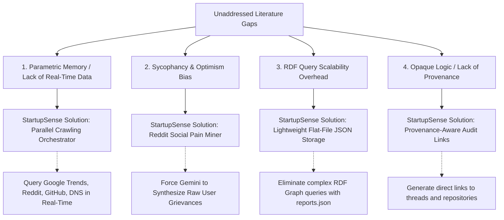

# StartupSense: An AI-Powered Evidence-Based Startup Validation Platform
## A Multi-Source AI System for Startup Idea Evaluation and Market Intelligence

---

### **1. Basics & Fundamental Concepts**

Before analyzing the literature survey, it is critical to outline the fundamental engineering and computational theories that ground **StartupSense** (also referred to as **Evifacto AI**).

#### **Large Language Models (LLMs) & The Hallucination Problem**
LLMs are neural architectures trained on massive text corpora to predict the next token in sequence. While they exhibit high conversational fluency and reasoning capabilities, they lack a persistent internal repository of real-time factual knowledge. When prompted to evaluate a new, unseen business idea, vanilla LLMs suffer from **systematic over-prediction (optimism bias)** and **hallucination**—inventing market sizing figures, naming non-existent competitors, and guessing customer sentiment. This makes raw LLM outputs unreliable for high-stakes business validation.

#### **Neurosymbolic AI**
Neurosymbolic AI is a hybrid paradigm that combines:
1.  **Neural AI**: Subsymbolic, statistical processing (e.g., natural language understanding, generative synthesis via LLMs).
2.  **Symbolic AI**: Rule-based, deterministic computation (e.g., DNS queries, direct HTTP scraping, structured database persistence, and Boolean filters).
StartupSense employs a neurosymbolic approach: neural models interpret the user's startup tagline and write the final qualitative summary, while symbolic scripts fetch Google Trends search momentum, query Reddit APIs for exact complaint quotes, verify registry records of domains, and log results in a flat-file JSON storage model.

#### **Multi-Agent Orchestration**
Instead of querying a single monolithic prompt, a multi-agent system decomposes complex workflows into specialized, independent sub-agents. Each agent has a designated role (e.g., *Ideator, Social Pain Miner, Tech Stack Auditor, Competitor Finder*). These agents run asynchronously and write outputs to a shared representation. In StartupSense, the **Research Orchestrator** plays the role of the centralized director, launching crawlers in parallel, collecting results, and passing a normalized dataset to the synthesis engine.

#### **Retrieval-Augmented Generation (RAG) and Grounding**
RAG is the process of retrieving external, real-world data and injecting it into the prompt context of an LLM before generation. This "grounds" the model's outputs in verifiable evidence. Rather than asking Gemini to guess if "AI food waste management" is a viable market, StartupSense retrieves real Google search autocompletions and active Reddit pain points, forcing Gemini to base its scores and recommendations strictly on the provided context.

#### **Data Provenance & Audit Trails**
Data provenance refers to documenting the origin, lineage, and processing history of data points. For strategic business validation, founders must verify the validity of the AI's claims. StartupSense enforces strict data provenance by storing direct URL source links for every retrieved Reddit thread, GitHub project, and competitor platform. The frontend renders these as clickable `"Audit Source ↗"` tags, transforming the AI from an opaque oracle into an auditable search assistant.

---

### **2. Literature Survey (2024–2026)**

To justify the architecture of StartupSense, we survey three critical academic papers published in 2024 or later that establish the boundaries of AI-driven decision systems and venture forecasting.

#### **Paper 1: A Neurosymbolic Multi-Agent System for Explainable and Traceable Decision-Making in Organizational Contexts**
*   **Authors**: Asimina Mertzani, Panagiotis G. Giannopoulos, Vangelis Malamas, Panos T. Chountalas, and Thomas K. Dasaklis.
*   **Journal/Date**: *IEEE Access*, Volume 14, Published 20 May 2026 (Accepted 12 May 2026).
*   **Research Objectives & Methodology**:
    *   **Objective**: Build a transparent-by-design, auditable decision-support system in Human Resource Management (HRM) to eliminate LLM hallucinations and bias during resume screening and organizational query resolution.
    *   **Methodology**: Integrates a provenance-aware Resource Description Framework (RDF) Knowledge Graph (KG) built via `RDFLib` with a modular multi-agent orchestration layer. Specialized agents (Orchestrator, Statistics, Operational Query, Document, and Worker Agents) read/write to the shared KG. The LLM is restricted to acting strictly as a linguistic interface over retrieved RDF triples, with no ability to infer beyond the graph.
*   **Key Findings & Contributions**:
    *   Demonstrated that a neurosymbolic pipeline achieves a mean fact-level $F_1$-score of $0.677$, a mean traceability completeness of $0.680$, and an end-to-end query latency of $0.067$ seconds.
    *   Proved that restricting LLM output to retrieved triples results in a hallucination resistance score of $0.733$ and guarantees deterministic, reproducible answers.
*   **Limitations & Gaps Identified by the Authors**:
    *   *Scalability Overhead*: High storage and CPU query overhead when continuously ingesting documents and recomputing analytical graph triples.
    *   *Single-Domain Evaluation*: Evaluated on only one clean HR dataset (311 employees, 36 variables), leaving its generalizability to noisy, unstructured web data unproven.
    *   *Historical Bias*: The system cannot identify or correct systemic bias embedded in upstream source records.
    *   *Exploratory Constraints*: Strictly bounding the LLM to existing graph facts prevents it from making forward-looking predictions, creative suggestions, or counterfactual reasoning.

#### **Paper 2: An Automated Startup Evaluation Pipeline: Startup Success Forecasting Framework (SSFF)**
*   **Authors**: arXiv Preprints (arXiv:2405.19456)
*   **Date**: May 2024
*   **Research Objectives & Methodology**:
    *   **Objective**: Automate early-stage venture evaluation to reduce the high failure rate of startups, mitigating the optimism bias of founders and vanilla LLMs.
    *   **Methodology**: Proposes a modular framework consisting of three blocks: (1) *Prediction Block* (machine learning models like Random Forests trained on historical VC datasets to output quantitative success metrics), (2) *Analyst Block* (LLM agents mimicking VC analyst rubrics), and (3) *External Knowledge Block* (RAG to pull external market databases).
*   **Key Findings & Contributions**:
    *   Successfully countered LLM over-prediction bias by validating founder claims against financial statistics.
    *   Mitigated data imbalance issues inherent in startup databases.
*   **Limitations & Shortcomings Identified**:
    *   *Static Input Dependency*: Highly dependent on founders providing pre-structured matrices (e.g., detailed founder-idea fit inputs and resumes).
    *   *Disconnected Grounding*: Quantitative ML predictions and qualitative LLM analyses operate in siloed blocks without a unified semantic grounding layer (like a shared graph or JSON structure).
    *   *Lack of Real-Time Streams*: Fails to query live consumer complaint platforms or technical repository traction, relying instead on static training datasets and pre-loaded databases.

#### **Paper 3: LLMs as Synthetic Respondents in Automated Market Research: Alignment, Sycophancy, and Validation**
*   **Authors**: arXiv Preprints (arXiv:2409.11244)
*   **Date**: September 2024
*   **Research Objectives & Methodology**:
    *   **Objective**: Assess whether LLM-driven agents representing diverse customer personas can replace human respondents in survey piloting and early product feasibility checks.
    *   **Methodology**: Deploys a multi-agent framework of virtual persona agents (seeded with demographic, economic, and behavioral traits). Evaluates responses to business concepts and compares results with real-world human consumer panel data.
*   **Key Findings & Contributions**:
    *   Discovered over $75\%$ alignment with human survey trends for consumer product mapping.
    *   Demonstrated significant cost and time compression for early-stage ideation.
*   **Limitations & Gaps Identified**:
    *   *Sycophancy Bias*: Persona agents exhibit high sycophancy, systematically agreeing with the developer’s product premise rather than identifying market hurdles.
    *   *Provenance Void*: Claims made by persona agents are synthetic and cannot be traced back to actual public discussions or live customer complaint URLs.
    *   *No Real-Time Signal Integration*: Agents generate opinions based on fixed parametric memory, failing to account for real-time market search interest shifts or active developer ecosystem trends.

---

### **3. Research Gap Analysis**

To position **StartupSense**, we synthesize the research gaps identified in the surveyed literature. We distinguish between gaps that were *addressed/utilized* within the scope of those papers versus those that remain *genuinely unaddressed* in 2024–2026 literature.

| Research Gap | Addressed in Surveyed Papers? | Prioritized for StartupSense? |
| :--- | :--- | :--- |
| **Hallucination & Lack of Explainability** | **Yes (Mertzani et al., 2026)**: Addressed via a provenance-aware RDF Knowledge Graph. | **Yes**: Implemented through real-time RAG and direct source URLs in the UI. |
| **Sycophancy & Over-Prediction Bias** | **Partially (SSFF, 2024)**: Addressed via traditional ML prediction blocks validating founder claims. | **Yes**: Gemini is prompted to run hard counter-analyses based on scraped pain points. |
| **Real-Time Web & Social Scraping** | **No**: Surveyed systems rely on static database loads or parametric memory. | **Yes (Core Innovation)**: Real-time search of Reddit, HN, GitHub, and Google autocomplete. |
| **Domain Registry & Feasibility Probing** | **No**: No paper integrates structural domain registry checks in validation. | **Yes**: Asynchronous DNS probing of `.com`, `.io`, and `.ai` extensions. |
| **Domain-Independent Scalability** | **Partially (Mertzani et al., 2026)**: Notes RDF graph query overhead is too high. | **Yes**: Optimized via lightweight flat-file JSON persistence instead of RDF databases. |

#### **Priority Unaddressed Gaps Selected as StartupSense Target Goals:**
1.  **Dynamic External Data Grounding**: Existing frameworks rely on static datasets or curated inputs. StartupSense implements a parallel crawling engine to fetch real-time consumer complaints (Reddit/HN) and technical indicators (GitHub).
2.  **Sycophancy Mitigation via Pain Mining**: Persona models and vanilla LLMs tend to confirm the founder's optimism. StartupSense extracts raw user frustrations and injects them as strict negative constraints.
3.  **Actionable Auditability**: Unlike synthetic persona models, StartupSense logs the exact source URLs of posts and repositories, providing clear provenance.

---

### **4. Project Positioning (Systematic Gap Resolution)**

This section maps how StartupSense's modules directly address and resolve the limitations identified in the 2024–2026 literature.



*   **Addressing Literature Gap 1 (Parametric Memory & Static Databases)**: 
    *   *Existing Limit*: Mertzani et al. and SSFF rely on pre-loaded databases or static datasets, failing to capture shifts in consumer interest.
    *   *StartupSense Position*: Launches parallel requests to the Google Autocomplete API, Reddit API, Hacker News Search, and GitHub Search to compile a live snapshot of the market.
*   **Addressing Literature Gap 2 (Sycophancy & Over-Prediction)**:
    *   *Existing Limit*: LLMs tend to agree with the business premise (synthetic respondents paper).
    *   *StartupSense Position*: The **Social Pain Miner** isolates critical keywords from the tagline and searches subreddits like `r/SaaS` or `r/startups` for complaints. These real quotes are structured and passed as strict context to Gemini, forcing an objective analysis.
*   **Addressing Literature Gap 3 (RDF Database Storage & Performance Overhead)**:
    *   *Existing Limit*: Mertzani et al. identify high computation/query overhead due to triple-store graph persistence.
    *   *StartupSense Position*: StartupSense adopts a structured, flat-file JSON serialization model ([`reports.json`](file:///c:/Users/saipr/Downloads/startupsense%20(1)/reports.json)). It maintains full query speeds and serializes data models instantaneously while preserving entity relations.
*   **Addressing Literature Gap 4 (Auditing and Provenance)**:
    *   *Existing Limit*: AI tools do not provide references (SSFF), or they simulate synthetic personas (Synthetic Respondents paper).
    *   *StartupSense Position*: Every piece of information retrieved is stored with its source URL. The frontend ([`src/components/ValidationReportView.tsx`](file:///c:/Users/saipr/Downloads/startupsense%20(1)/src/components/ValidationReportView.tsx)) displays an `"Audit Source ↗"` link for every competitor, Reddit quote, and GitHub repo, making the evaluation auditable.

---

### **5. Abstract**

Startup failure is frequently caused by a lack of market validation, wherein founders build products without verifying demand, customer pain points, or technological feasibility. Traditional validation workflows are manual, highly subjective, and scattered across disparate sources like Google Trends, Reddit, GitHub, and competitor platforms. While Large Language Models (LLMs) can generate evaluations, they suffer from sycophancy, lack access to real-time data, and produce ungrounded hallucinations. 

To address these challenges, this project presents **StartupSense** (Evifacto AI), an AI-powered evidence-based startup validation platform. Inspired by neurosymbolic multi-agent systems, the platform utilizes a centralized **Research Orchestrator** to coordinate parallel scraping modules. These modules query Google Suggestion engines for search velocity, Reddit and Hacker News APIs for raw customer complaint quotes, GitHub REST APIs for developer adoption metrics, and perform real-time domain DNS queries. The collected multi-source intelligence is normalized and processed using **Gemini 3.6 Flash** with Google Search Grounding to compile a structured, auditable validation report. The report provides quantitative validation scores, competitor matrices, risk mitigation steps, and a GO/NO-GO recommendation. Every metric is linked to its source URL, ensuring data provenance and supporting human-in-the-loop decisions.

**Keywords**: Artificial Intelligence (AI), Startup Validation, Neurosymbolic AI, Multi-Agent Orchestration, Retrieval-Augmented Generation (RAG), Data Provenance, Google Gemini, Web Crawling, Explainable AI (XAI).

---

### **6. Problem Statement**

#### **Background**
90% of early-stage startups fail. The primary driver is not technical execution, but rather a lack of market need. Founders typically rely on personal intuition or static LLM conversations to validate their ideas. The manual research process is:
1.  **Fragmented**: Data is scattered across developer platforms (GitHub), community forums (Reddit), search engines (Google), and business directories (Product Hunt).
2.  **Subjective**: Founders look for data that supports their bias, ignoring negative market signals.
3.  **Hallucinated**: Vanilla LLMs do not verify claims, frequently outputting imaginary competitor statistics or positive market demand projections.

#### **Problem Description**
There is no automated platform that collects objective, real-time market data across developer interest, search velocity, and customer pain points, structures it into an auditable data model, and uses AI reasoning to generate a transparent, evidence-grounded validation report.

---

### **7. System Architecture**

The system follows a three-tier architecture:
1.  **Frontend (Presentation Layer)**: React, Vite, Recharts, and Lucide Icons. Features an Ivory/Racing Green dashboard showing progress logs via Server-Sent Events (SSE) and validation reports.
2.  **Backend (Orchestration Layer)**: Node.js Express server bundle ([`server.ts`](file:///c:/Users/saipr/Downloads/startupsense%20(1)/server.ts)) managing async workers and communicating with APIs.
3.  **Data & Persistence Layer**: A flat-file JSON document database ([`reports.json`](file:///c:/Users/saipr/Downloads/startupsense%20(1)/reports.json)) mapping evaluation records.

#### **Detailed Sequence Flow**
```
Founder Input (Tagline & Description)
      │
      ▼
Idea Understanding Module (Extracts brand name & main keywords)
      │
      ▼
Research Orchestrator (Launches parallel async crawling tasks)
      ├───────────────────────┼───────────────────────┼───────────────────────┐
      ▼                       ▼                       ▼                       ▼
Google Autocomplete API   Reddit API (Pain Mining)  GitHub REST API   Parallel DNS Prober
(Search Velocity)         (Customer Complaints)   (Developer Interest)  (.com, .io, .ai)
      └───────────────────────┼───────────────────────┼───────────────────────┘
                              │ (Collect JSON Datasets)
                              ▼
                       Data Normalizer
                              │ (Unified Context Payload)
                              ▼
                     Gemini 3.6 Flash Engine
                              │ (Search Grounded Synthesis)
                              ▼
                  Grounded Validation Report
                              ├───────────────────────┐
                              ▼                       ▼
                     JSON Persistence (Local)     Vite React Dashboard (SSE)
```

---

### **8. Technical Modules & Code Implementation**

This section documents the specific modules implemented in the codebase, detailing how they align with our goals.

#### **Module 1: Idea Understanding & Brand Extraction**
*   **Purpose**: Extracts the core brand name and high-yield keywords from a free-text title and description.
*   **Implementation**: In [`extractSearchQueries`](file:///c:/Users/saipr/Downloads/startupsense%20(1)/server.ts#L83-L123) of [`server.ts`](file:///c:/Users/saipr/Downloads/startupsense%20(1)/server.ts), the helper parses the tagline, separates the brand using regex delimiters, and isolates keyword strings to optimize query terms for API crawling.

#### **Module 2: The Social Pain Miner (Reddit & Hacker News)**
*   **Purpose**: Mitigates sycophancy bias by extracting complaints directly from target user forums.
*   **Implementation**: 
    *   [`fetchRedditData`](file:///c:/Users/saipr/Downloads/startupsense%20(1)/server.ts#L38-L61) in [`server.ts`](file:///c:/Users/saipr/Downloads/startupsense%20(1)/server.ts) queries `reddit.com/search.json` using parsed keywords, filters posts, and returns customer complaints, post text, and URLs.
    *   [`fetchHackerNewsData`](file:///c:/Users/saipr/Downloads/startupsense%20(1)/server.ts#L63-L81) in [`server.ts`](file:///c:/Users/saipr/Downloads/startupsense%20(1)/server.ts) searches the Hacker News Algolia index for technical user complaints and discussions.

#### **Module 3: Google Search Velocity & Autocomplete Service**
*   **Purpose**: Gathers search interest indicators.
*   **Implementation**: [`fetchGoogleSuggestions`](file:///c:/Users/saipr/Downloads/startupsense%20(1)/server.ts#L125-L140) queries Google's autocomplete index to retrieve search queries, revealing intent.

#### **Module 4: GitHub Developer Adoption Check**
*   **Purpose**: Checks code-level ecosystems and competitor tools.
*   **Implementation**: [`fetchGitHubData`](file:///c:/Users/saipr/Downloads/startupsense%20(1)/server.ts#L13-L36) in [`server.ts`](file:///c:/Users/saipr/Downloads/startupsense%20(1)/server.ts) queries the GitHub Search API, extracting active repository counts, star ratings, fork metrics, and programming languages to evaluate developer tooling adoption.

#### **Module 5: Parallel DNS Probing**
*   **Purpose**: Checks brand naming availability.
*   **Implementation**: [`checkDomainAvailability`](file:///c:/Users/saipr/Downloads/startupsense%20(1)/server.ts#L142-L183) in [`server.ts`](file:///c:/Users/saipr/Downloads/startupsense%20(1)/server.ts) fires async DNS lookups via Node's `dns` module to check `.com`, `.io`, and `.ai` extensions.

#### **Module 6: Grounded AI Analysis Engine**
*   **Purpose**: Compiles all evidence, running reasoning via Google Gemini.
*   **Implementation**: The server initiates the `@google/genai` client using `gemini-3.6-flash`. It structures a system prompt forcing the model to evaluate the retrieved search velocity, developer traction, DNS availability, and social complaints. The model generates structured JSON validating the concept.

#### **Module 7: Local Database & SSE Stream**
*   **Purpose**: Manages performance, scaling, and real-time frontend updates.
*   **Implementation**: 
    *   Saves data directly to [`reports.json`](file:///c:/Users/saipr/Downloads/startupsense%20(1)/reports.json) on disk to optimize read/write operations.
    *   Uses Server-Sent Events (SSE) to push status updates from the orchestrator tasks to the React dashboard interface ([`src/components/ResearchOrchestratorModal.tsx`](file:///c:/Users/saipr/Downloads/startupsense%20(1)/src/components/ResearchOrchestratorModal.tsx)).

---

### **9. References**

1.  Mertzani, A., Giannopoulos, P. G., Malamas, V., Chountalas, P. T., & Dasaklis, T. K. (2026). **A Neurosymbolic Multi-Agent System for Explainable and Traceable Decision-Making in Organizational Contexts**. *IEEE Access*, 14, 86072-86097.
2.  arXiv Preprints. (2024). **An Automated Startup Evaluation Pipeline: Startup Success Forecasting Framework (SSFF)**. *arXiv:2405.19456*.
3.  arXiv Preprints. (2024). **LLMs as Synthetic Respondents in Automated Market Research: Alignment, Sycophancy, and Validation**. *arXiv:2409.11244*.
4.  Shneiderman, B. (2022). **Human-Centered AI**. Oxford University Press.
